# Class Activity 1 --- System Calls in Practice

-   **Student Name:** Din Mengsea
-   **Student ID:** E20230752
-   **Date:** October 29, 2026

------------------------------------------------------------------------

## Warm-Up: Hello System Call

Screenshot of running `hello_syscall.c` on Linux:

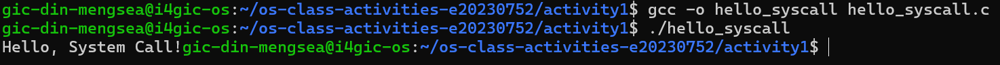

### Windows API example --- unable to run on Ubuntu

I could not run `hello_winapi.c` on the Ubuntu server because it uses
the Windows-specific header `windows.h` and Windows API functions such
as `WriteFile()` and `GetStdHandle()`. Compilation failed with the error
`windows.h: No such file or directory`.

This program needs to be compiled in a Windows environment with a
compatible compiler, such as MinGW-w64 or Microsoft Visual C++ (MSVC). I
could not capture a screenshot of it running on Windows, so no
successful-run screenshot is included.

Screenshot of running `copyfilesyscall.c` on Linux:

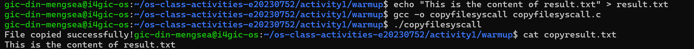

------------------------------------------------------------------------

## Task 1: File Creator & Reader

### Part A --- File Creator

**Implementation notes:** The library version uses C standard library
functions, while the system-call version uses POSIX calls directly. The
system-call version must explicitly open the file, check for errors,
write the content, and close the file descriptor.

**Version A --- Library Functions (`file_creator_lib.c`):**

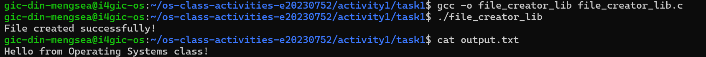

**Version B --- POSIX System Calls (`file_creator_sys.c`):**

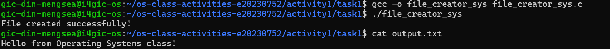

**Questions**

1.  **What flags did you pass to `open()`? What does each flag mean?**

    `O_WRONLY` opens the file for writing only. `O_CREAT` creates the
    file if it does not exist. `O_TRUNC` clears the existing contents if
    the file already exists. These flags can be combined using the
    bitwise OR operator (`|`).

2.  **What is `0644`? What does each digit represent?**

    `0644` is an octal permission mode used when creating a file. The
    owner has read and write permissions (`6`), while the group and
    other users have read permission only (`4` and `4`). The leading `0`
    indicates an octal number in C.

3.  **What does `fopen("output.txt", "w")` do internally that you had to
    do manually?**

    `fopen()` handles opening or creating the file and prepares a C
    standard I/O stream. With mode `"w"`, it creates the file if needed
    and truncates an existing file. In the system-call version, I used
    `open()` with the appropriate flags and had to manage the returned
    file descriptor and call `close()` myself.

### Part B --- File Reader & Display

**Implementation notes:** The library version uses functions such as
`fopen()` and `fgets()`. The system-call version uses `open()`,
`read()`, `write()`, and `close()` to read and display the file content.

**Version A --- Library Functions (`file_reader_lib.c`):**

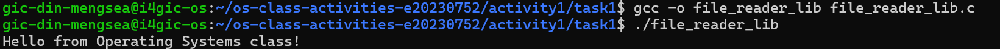

**Version B --- POSIX System Calls (`file_reader_sys.c`):**

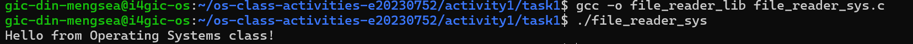

**Questions**

1.  **What does `read()` return? How is this different from `fgets()`?**

    `read()` returns the number of bytes read, `0` at end-of-file, or
    `-1` if an error occurs. `fgets()` reads characters into a string
    until it reaches a newline, the buffer limit, or end-of-file, and it
    adds a null terminator when successful.

2.  **Why do you need a loop when using `read()`? When does it stop?**

    A loop allows the program to process a file in chunks because one
    `read()` call is not guaranteed to return the entire file. The loop
    normally continues while `read()` returns a positive number, and
    stops when it returns `0` at end-of-file or `-1` on error.

------------------------------------------------------------------------

## Task 2: Directory Listing & File Info

**Implementation notes:** The library version uses directory and
file-information functions from the C/POSIX library. The system-call
version uses lower-level operations to open and read a directory and
retrieve metadata.

### Version A --- Library Functions (`dir_list_lib.c`)

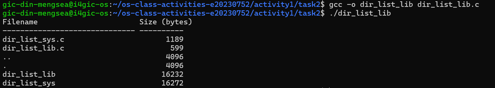

### Version B --- System Calls (`dir_list_sys.c`)

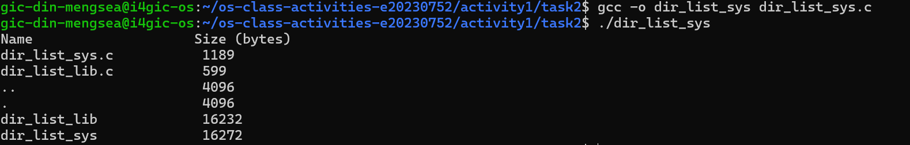

### Questions

1.  **What struct does `readdir()` return? What fields does it
    contain?**

    `readdir()` returns a pointer to a `struct dirent` for the next
    directory entry, or `NULL` when there are no more entries or an
    error occurs. Common fields include `d_name`, the entry name, and
    `d_ino`, the inode number. Available fields can vary by system.

2.  **What information does `stat()` provide beyond file size?**

    `stat()` provides metadata such as file type and permissions, inode
    number, owner and group IDs, timestamps, and the number of blocks
    allocated.

3.  **Why can't you `write()` a number directly --- why do you need
    `snprintf()` first?**

    `write()` writes bytes from a memory buffer; it does not convert an
    integer into readable decimal text. `snprintf()` converts the number
    into a string in a character buffer, which can then be passed to
    `write()`.

------------------------------------------------------------------------

## Task 3: `strace` Analysis

**Observation:** `strace` shows the system calls made by a program. A C
library function such as `fprintf()` may perform buffering and other
setup before it invokes system calls such as `write()`. The exact counts
depend on the program, its output, and the environment.

### `strace` Output --- Library Version (File Creator)

### `strace` Output --- System Call Version (File Creator)

### `strace` Output --- Library Version (File Reader)

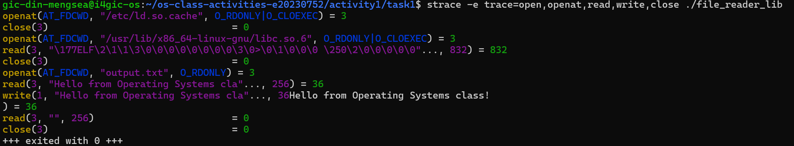

### `strace` Output --- System Call Version (File Reader)

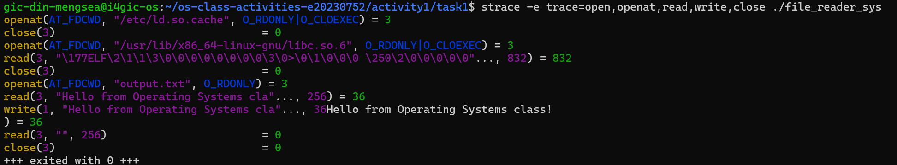

### `strace -c` Summary Comparison

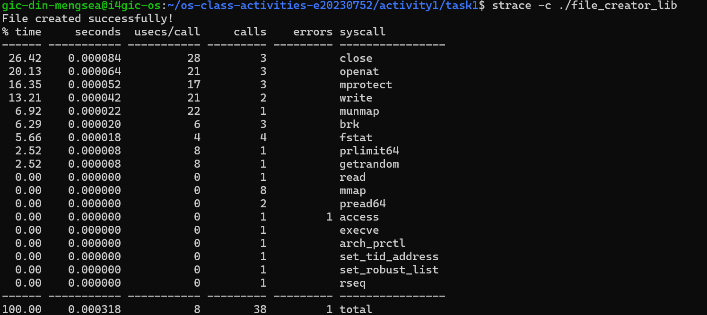

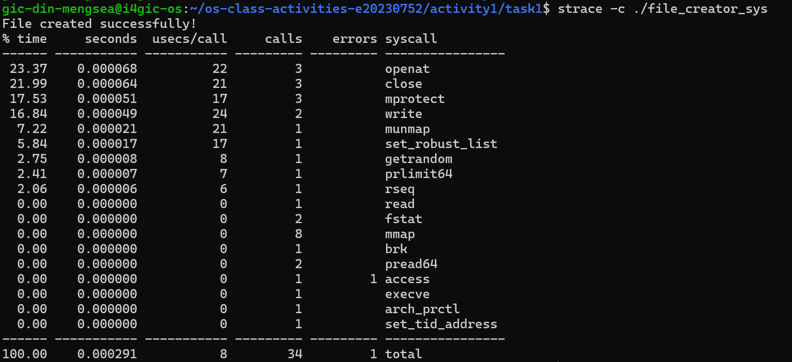

### Questions

1.  **How many system calls does the library version make compared to
    the system-call version?**

    Use the total number of calls shown in the two `strace -c` summary
    screenshots. Library version: **\[enter the total from your
    screenshot\]**. System-call version: **\[enter the total from your
    screenshot\]**. The difference is the library total minus the
    system-call total.

2.  **What extra system calls appear in the library version? What do
    they do?**

    The exact extra calls should be identified from my trace output.
    Common examples include `brk` and `mmap`, which can be used for
    memory allocation, and `fstat` or related metadata calls, which
    retrieve file information. These calls are not guaranteed to appear
    in every run.

3.  **How many `write()` calls does `fprintf()` actually produce?**

    The answer depends on buffering and the program's output. I should
    count the `write()` calls in my actual `strace` output rather than
    assume that every `fprintf()` corresponds to exactly one system
    call.

4.  **In your own words, what is the real difference between a library
    function and a system call?**

    A library function is an interface provided by a programming
    library. It may perform extra work such as formatting, buffering,
    and error handling, and it may call one or more system calls. A
    system call is the mechanism through which a program requests a
    service from the operating-system kernel.

------------------------------------------------------------------------

## Task 4: Exploring OS Structure

### System Information

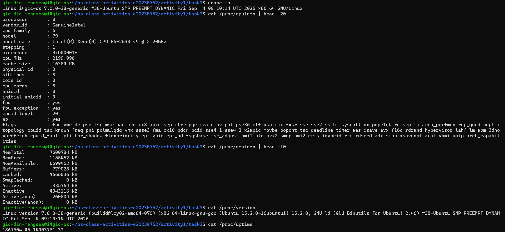

### Process Information

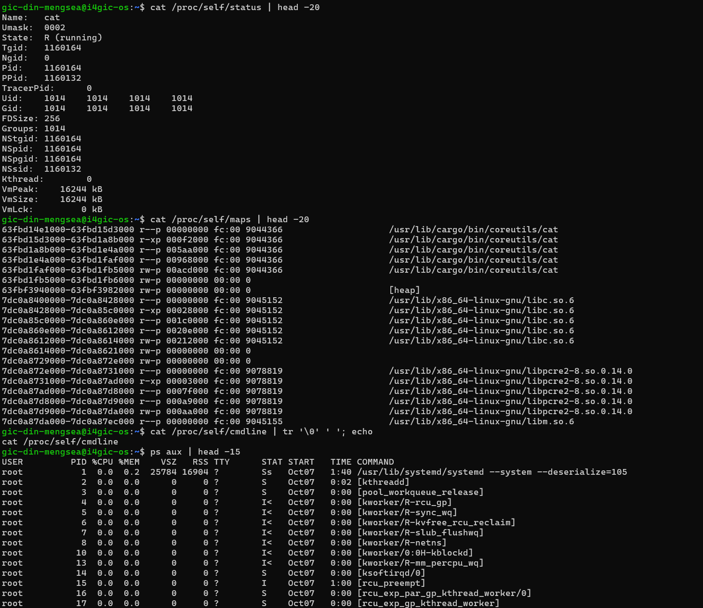

### Kernel Modules

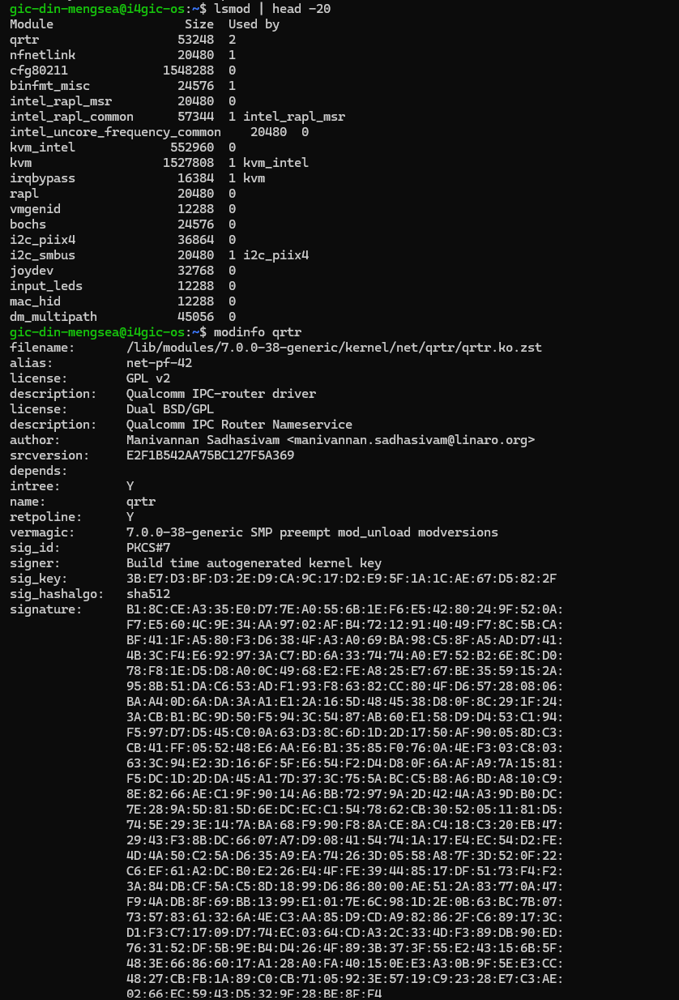

### OS Layers Diagram

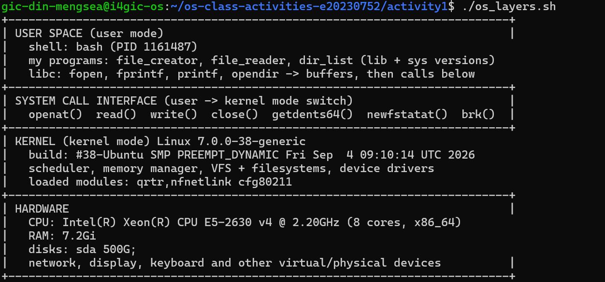

### Questions

1.  **What is `/proc`? Is it a real filesystem on disk?**

    `/proc` is a virtual filesystem provided by the Linux kernel. It
    exposes information about processes and system state. Its entries
    are generated by the kernel and generally do not represent ordinary
    files stored on disk.

2.  **Monolithic kernel vs. microkernel --- which type does Linux use?**

    Linux uses a monolithic kernel design, with many core
    operating-system services running in kernel space. It also supports
    loadable kernel modules, so functionality can be added or removed
    without rebuilding the entire kernel.

3.  **What memory regions do you see in `/proc/self/maps`?**

    The exact regions depend on the process. Common entries include the
    program's executable mappings, heap, shared libraries, stack, and
    virtual mappings. The permissions shown indicate whether each
    mapping is readable, writable, or executable.

4.  **Break down the kernel version string from `uname -a`.**

    The `uname -a` output includes the kernel name, host name, kernel
    release, version/build information, machine architecture, and
    operating-system information. The exact release and build string
    should be read from the screenshot captured on my system.

5.  **How does `/proc` show that the OS is an intermediary between
    programs and hardware?**

    `/proc` exposes kernel-managed information about hardware, memory,
    processes, and system state through a consistent interface. Programs
    can inspect this information without directly accessing the
    hardware, illustrating the operating system's role between
    applications and hardware.

------------------------------------------------------------------------

## Reflection

This activity helped me understand that system calls provide a
controlled interface between user programs and the Linux kernel. Library
functions make common tasks easier by providing higher-level features,
but they may perform additional work before reaching the kernel. Using
`strace` helped me observe system-call activity, while `/proc` and
kernel information commands helped me explore the operating system's
structure.

------------------------------------------------------------------------

## Notes

-   The Windows API example could not be run in the Ubuntu environment
    because `windows.h` and the Windows API are not natively available
    there. The Windows screenshot is therefore intentionally omitted.
-   Before submission, replace the Task 3 placeholders with the exact
    counts from the saved `strace -c` output.
-   Check that every screenshot filename used above exists in the
    `screenshots/` folder.
