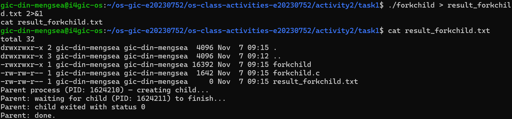
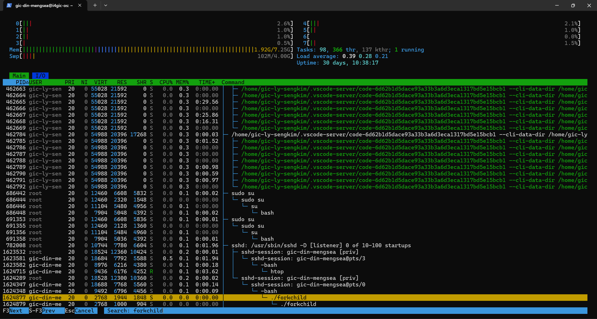
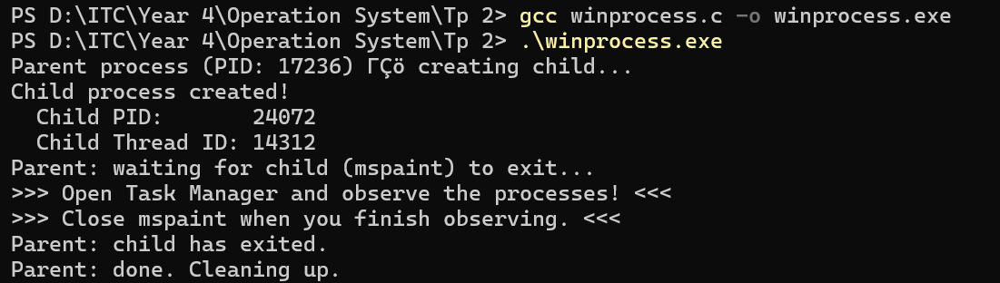
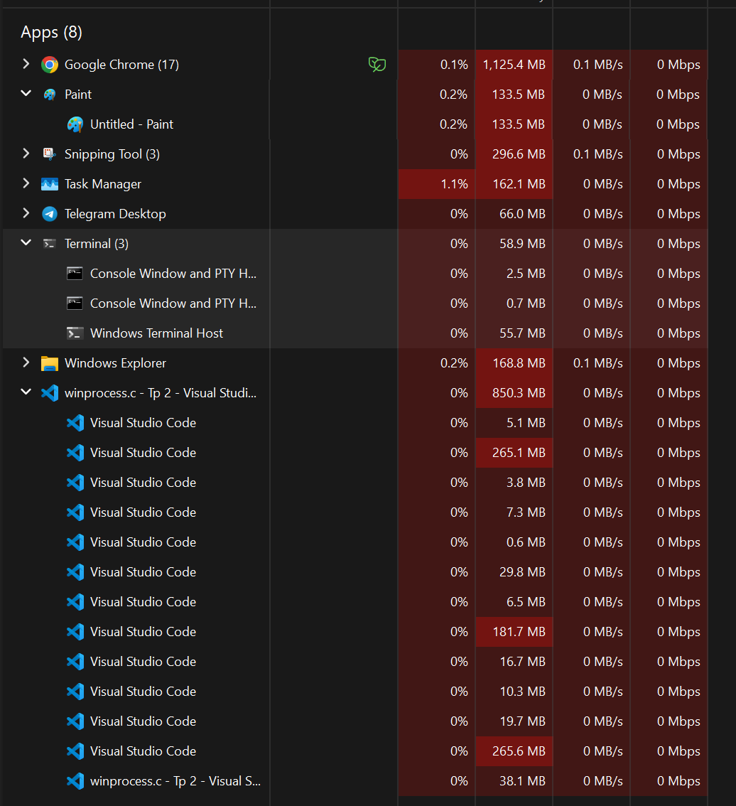
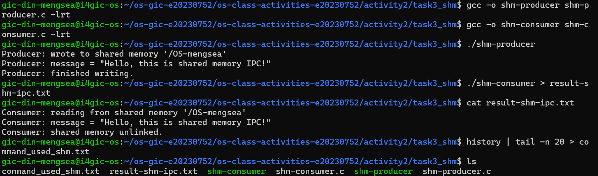
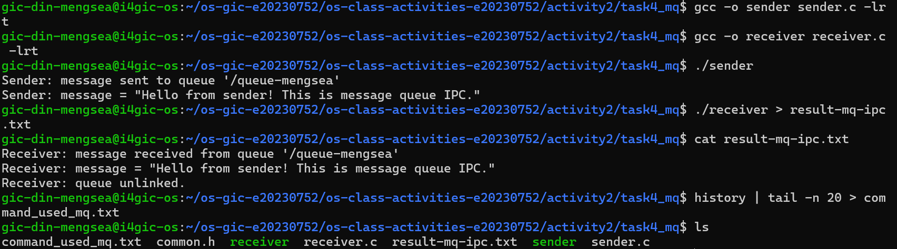

# Class Activity 2 — Processes & Inter-Process Communication

- **Student Name:** Din Mengsea
- **Student ID:** E20230752
- **Date:** November 7, 2026

---

# Task 1: Process Creation on Linux (fork + exec)

## 1. Compilation & Execution

First, compile `forkchild.c` using GCC:

```bash
gcc forkchild.c -o forkchild
```

Execute the program:

```bash
./forkchild
```

The program successfully creates a child process using `fork()`. The child sleeps for 30 seconds before executing `ls -la` using `execlp()`. Meanwhile, the parent waits for the child to finish using `waitpid()`.

### Screenshot: Compilation & Execution



---

## 2. Process Tree

I used `htop` and pressed `F5` to switch to tree mode. The process tree showed the parent process with its child process indented underneath it.

I also used the following command to verify the relationship:

```bash
ps -C forkchild -o pid,ppid,cmd --forest
```

### Screenshot: Parent-Child Process Tree



---

## 3. Output

The following output shows the successful creation of the parent and child processes:

```text
Parent process (PID: 1624823) — creating child...
Parent: waiting for child (PID: 1624825) to finish...
Child process (PID: 1624825, Parent PID: 1624823)
Child: sleeping 30s — observe the process tree now!
```

Process verification using `ps`:

```text
PID       PPID      CMD
1624823   1624348   ./forkchild
1624825   1624823    \_ ./forkchild
```

*Note: The PIDs may change each time the program runs.*

---

## 4. Questions

### Question 1: What does `fork()` return to the parent? What does it return to the child?

The `fork()` system call returns different values depending on the process:

- **Parent process:** Returns the PID of the newly created child process. In my experiment, it returned `1624825`.
- **Child process:** Returns `0`, indicating that the code is executing inside the child process.
- **If fork fails:** Returns `-1`, and no child process is created.

These return values allow the program to distinguish between the parent and child processes.

### Question 2: What happens if you remove the `waitpid()` call? Why might the output look different?

If we remove `waitpid()`, the parent process will not wait for the child to finish.

As a result, the parent may continue executing and terminate before the child finishes. The output order may become different or unpredictable because both processes execute independently.

If the child terminates while its parent is still running without collecting its exit status, it may temporarily become a zombie process.

Therefore, `waitpid()` is important because it allows the parent to synchronize with the child and collect its termination status.

### Question 3: What does `execlp()` do? Why don't we see "execlp failed" when it succeeds?

`execlp()` is a function from the `exec` family that replaces the current process's program with a new program.

In my experiment, I used:

```c
execlp("ls", "ls", "-la", NULL);
```

This replaces the child process's program with `ls` and displays all files, including hidden files, with detailed information.

We do not see `"execlp failed"` when it succeeds because `execlp()` does not return to the original program after successful execution. Instead, the child process is replaced by the new program.

The `perror("execlp")` statement executes only if `execlp()` fails.

### Question 4: Draw the process tree for your program (parent → child). Include PIDs from your output.

Based on my experiment, the process tree is:

```text
Parent Process
PID: 1624823
    |
    └── Child Process
        PID: 1624825
        PPID: 1624823
        |
        └── Executes ls -la
```

The child's PPID is `1624823`, which matches the parent's PID. This confirms that the child process was successfully created using `fork()`.

Afterward, the child executes `ls -la` using `execlp()`. The process keeps the same PID even though its program changes.

### Question 5: Which command did you use to view the process tree (`ps --forest`, `pstree`, or `htop`)? What information does each column show?

I used both `htop` and the `ps` command to observe and verify the process tree.

The command I used was:

```bash
ps -C forkchild -o pid,ppid,cmd --forest
```

I also opened `htop` and pressed `F5` to enable tree mode.

The columns in the `ps` output provide the following information:

| Column | Meaning |
|---|---|
| PID | Process ID, a unique identifier for the process. |
| PPID | Parent Process ID, which identifies the parent of the process. |
| CMD | The command or program being executed by the process. |

In my experiment:

- The parent process had PID `1624823`.
- The child process had PID `1624825`.
- The child's PPID was `1624823`, matching the parent's PID.

The tree view in `htop` makes the parent-child relationship easier to understand visually because the child process is indented underneath its parent.

---

# Task 2: Process Creation on Windows

## 1. Compilation & Execution

First, I created the `winprocess.c` program using the Windows API.

I compiled the program using GCC in Windows PowerShell:

```powershell
gcc winprocess.c -o winprocess.exe
```

Then, I executed the program:

```powershell
.\winprocess.exe
```

The program successfully created a new child process using the Windows `CreateProcess()` function. The child process launched Microsoft Paint (`mspaint.exe`), while the parent process waited for the child to terminate using `WaitForSingleObject()`.

### Screenshot: Compilation & Execution



---

## 2. Task Manager Screenshots

### Screenshot 1: Task Manager — Processes Tab

I opened Windows Task Manager using `Ctrl + Shift + Esc` and navigated to the Processes tab.

**Note about the Process Tree:**

In my Windows Task Manager, the Processes tab did not display an expand arrow showing `mspaint.exe` nested under `winprocess.exe`, even though Microsoft Paint was running successfully.

I believe this is because Windows Task Manager groups applications based on their application windows rather than displaying the actual parent-child process hierarchy.

To verify the relationship, I used PowerShell to check the PID and Parent Process ID of both processes. The results confirmed that the Parent Process ID of `mspaint.exe` (22180) matched the PID of `winprocess.exe` (24512).

Therefore, although the expand arrow was not displayed in the Processes tab, I successfully verified that Microsoft Paint was created as a child process of my program using `CreateProcess()`..



### Screenshot 2: Task Manager — Details Tab

I opened the Details tab in Task Manager to identify the running processes and their Process IDs (PIDs).

I found the following processes:

- `winprocess.exe` — Parent process.
- `mspaint.exe` — Child process.


---

## 3. Process Verification Using PowerShell

Since Windows Task Manager did not provide a Parent Process ID column in the Select Columns menu, I used PowerShell to verify the parent-child relationship.

Command used:

```powershell
Get-CimInstance Win32_Process |
Where-Object { $_.Name -eq "winprocess.exe" -or $_.Name -eq "mspaint.exe" } |
Select-Object Name, ProcessId, ParentProcessId |
Format-Table -AutoSize
```

### Output

```text
Name           ProcessId ParentProcessId
----           --------- ---------------
winprocess.exe     24512           19360
mspaint.exe        22180           24512
```

The output confirmed that:

- The parent process `winprocess.exe` had PID `24512`.
- The child process `mspaint.exe` had PID `22180`.
- The Parent Process ID of `mspaint.exe` was `24512`, matching the PID of `winprocess.exe`.

This proves that Microsoft Paint was successfully created as a child process of my program.

## 4. Questions

### Question 1: What is the key difference between how Linux creates a process (`fork` + `exec`) and how Windows does it (`CreateProcess`)?

The main difference is the way each operating system creates a new process.

In Linux, process creation commonly involves two separate system calls:

- `fork()` creates a child process by duplicating the calling process.
- `exec()` replaces the child process's program with a new program.

In Windows, the `CreateProcess()` function performs process creation and program loading in one API call. It creates a new process and its primary thread directly.

Therefore, Linux commonly uses two steps (`fork()` and `exec()`), while Windows uses one main function (`CreateProcess()`) to create and start a new program.

### Question 2: What does `WaitForSingleObject()` do? What is its Linux equivalent?

`WaitForSingleObject()` is a Windows API function that makes the parent process wait until a specified object becomes signaled.

In my program, I used:

```c
WaitForSingleObject(pi.hProcess, INFINITE);
```

This makes the parent process wait until the child process (Microsoft Paint) terminates.

The Linux equivalent is `waitpid()`.

For example:

```c
waitpid(pid, &status, 0);
```

Both functions are used for process synchronization, allowing the parent to wait for the child process to finish before continuing.

### Question 3: Why do we need to call `CloseHandle()` at the end? What happens if we don't?

`CloseHandle()` is a Windows API function used to close an open handle to a system object, such as a process or thread.

In my program, I used:

```c
CloseHandle(pi.hProcess);
CloseHandle(pi.hThread);
```

These statements release the handles associated with the child process and its primary thread.

If we do not call `CloseHandle()`, the handles remain open until the parent process terminates. This can waste system resources. If a program creates many processes without closing their handles, it may eventually run out of available handles.

Therefore, `CloseHandle()` is important for proper resource management.

### Question 4: In Task Manager, what was the PID of your parent program and the PID of mspaint? Do they match your program's output?

Based on my experiment and PowerShell verification, the process information was:

| Process | PID | Parent Process ID |
|---|---:|---:|
| `winprocess.exe` | 24512 | 19360 |
| `mspaint.exe` | 22180 | 24512 |

The parent process `winprocess.exe` had PID `24512`, while the child process `mspaint.exe` had PID `22180`.

The Parent Process ID of `mspaint.exe` was `24512`, which matched the PID of `winprocess.exe`.

This confirms that Microsoft Paint was successfully created by my program using `CreateProcess()`.

The PID values were verified using PowerShell and Task Manager. They should also match the values printed by the program during the same execution.

### Question 5: Compare the Processes tab (tree view) and the Details tab (PID/PPID columns). Which view makes it easier to understand the parent-child relationship? Why?

The Processes tab and Details tab provide different ways to observe running processes.

**Processes tab:**

- Displays running applications and background processes.
- Groups related application windows together.
- Provides a visual overview of currently running applications.
- Does not always display the actual parent-child process hierarchy.

**Details tab:**

- Displays individual processes.
- Shows each process's PID.
- Allows users to identify processes by their executable names.
- Provides detailed process information, but Windows Task Manager does not include a Parent Process ID column in its standard Select Columns list.

In my experiment, I used the Processes tab to observe Microsoft Paint running and the Details tab to identify `winprocess.exe` and `mspaint.exe`.

I also used PowerShell to retrieve the Parent Process ID.

I prefer the Details tab together with PowerShell because they provide more precise process information and allow me to verify the parent-child relationship using PID and Parent Process ID values.

---


# Task 3: Shared Memory IPC

## 1. Compilation & Execution

First, I created two C programs:

- `shm-producer.c`: Creates shared memory and writes a message into it.
- `shm-consumer.c`: Opens the existing shared memory and reads the message.

I compiled both programs using GCC in Ubuntu.

**Compile the producer:**

```bash
gcc shm-producer.c -o shm-producer -lrt
```

**Compile the consumer:**

```bash
gcc shm-consumer.c -o shm-consumer -lrt
```

After successful compilation, I executed the producer first:

```bash
./shm-producer
```

Then, I executed the consumer:

```bash
./shm-consumer
```

The producer created a shared memory object named `/OS-mengsea` and wrote the message:

`Hello, this is shared memory IPC!`

The consumer then accessed the same shared memory object, read the message, and removed the shared memory name using `shm_unlink()`.

### Screenshot: Compilation & Execution



---

## 2. Output

### Producer Output

```text
Producer: wrote to shared memory '/OS-mengsea'
Producer: message = "Hello, this is shared memory IPC!"
Producer: finished writing.
```

### Consumer Output

```text
Consumer: reading from shared memory '/OS-mengsea'
Consumer: message = "Hello, this is shared memory IPC!"
Consumer: shared memory unlinked.
```

*Note: These are the expected outputs based on the completed programs. Replace them with the actual output from your `result-shm-ipc.txt` if it differs.*

---

## 3. Questions

### Question 1: What does `shm_open()` do? How is it different from `open()`?

`shm_open()` is a POSIX function used to create or open a shared memory object that can be accessed by multiple processes.

In my experiment, I used:

```c
shm_fd = shm_open(name, O_CREAT | O_RDWR, 0666);
```

In the producer, `O_CREAT` creates the shared memory object if it does not already exist, while `O_RDWR` allows reading and writing.

The main difference is:

- `shm_open()` creates or opens a POSIX shared memory object.
- `open()` creates or opens a regular file in the filesystem.

Shared memory allows multiple processes to access the same memory region, making it useful for inter-process communication (IPC).

### Question 2: What does `mmap()` do? Why is shared memory faster than other IPC methods?

`mmap()` is a system call that maps a file or shared memory object into a process's virtual address space.

In my experiment, I used:

```c
ptr = mmap(NULL, SIZE, PROT_READ, MAP_SHARED, shm_fd, 0);
```

This allows the consumer to access the shared memory directly through a pointer.

Shared memory is generally faster than other IPC methods, such as pipes and message queues, because multiple processes can access the same memory region without repeatedly copying messages between processes through the kernel.

Therefore, shared memory is useful when processes need to exchange large amounts of data efficiently.

### Question 3: Why must the shared memory name match between producer and consumer?

The shared memory name must match because both processes need to access the same shared memory object.

In my experiment, both programs used:

```c
const char *name = "/OS-mengsea";
```

The producer uses `shm_open()` with `O_CREAT | O_RDWR` to create or open the shared memory object.

The consumer uses `shm_open()` with `O_RDONLY` to open the existing object and read its contents.

If the names are different, the consumer will not be able to access the shared memory created by the producer. It may return an error such as `No such file or directory`.

Therefore, both programs must use exactly the same shared memory name.

### Question 4: What does `shm_unlink()` do? What would happen if the consumer didn't call it?

`shm_unlink()` is a POSIX function that removes the name of a shared memory object.

In my consumer program, I used:

```c
shm_unlink(name);
```

After the consumer finishes reading the message, it calls `shm_unlink()` to remove the shared memory object's name.

If the consumer does not call `shm_unlink()`, the shared memory object may remain available in the system even after the processes finish.

This can waste system resources if the object is no longer needed.

Therefore, `shm_unlink()` is important for cleaning up shared memory objects after communication is complete.

### Question 5: If the consumer runs before the producer, what happens? Try it and describe the error.

If the consumer runs before the producer creates the shared memory object, the consumer cannot open it because it uses:

```c
shm_fd = shm_open(name, O_RDONLY, 0666);
```

The consumer only opens an existing shared memory object and does not create a new one.

Therefore, if the shared memory object does not exist, `shm_open()` returns `-1` and displays an error.

Expected error:

```text
shm_open: No such file or directory
Hint: Did you run shm-producer first?
```

This happens because the producer must create the shared memory object before the consumer can access it.

Therefore, the correct execution order is to run the producer first and then run the consumer.

---

# Task 4: Message Queue IPC
## Compilation & Execution

The sender and receiver programs were compiled using GCC with the real-time library (`-lrt`).

**Compile the sender:**
```bash
gcc sender.c -o sender -lrt
```

**Compile the receiver:**
```bash
gcc receiver.c -o receiver -lrt
```

**Run the sender first:**
```bash
./sender
```

**Run the receiver:**
```bash
./receiver
```

**Screenshot – Compilation and Execution:**



## Output

**Sender output:**
```text
Sender: message sent to queue '/queue-mengsea'
Sender: message = "Hello from sender! This is message queue IPC."
```

**Receiver output:**
```text
Receiver: message received from queue '/queue-mengsea'
Receiver: message = "Hello from sender! This is message queue IPC."
Receiver: queue unlinked.
```

## Questions

**1. How is a message queue different from shared memory? When would you use one over the other?**

A message queue allows processes to communicate by sending and receiving messages through an operating-system-managed queue. Shared memory allows multiple processes to access the same memory region directly.

Message queues are easier to use when processes need to exchange separate messages because the operating system manages message delivery. Shared memory is more suitable when processes need to exchange large amounts of data quickly because they access the same memory directly. However, shared memory usually requires additional synchronization.

**2. Why does the queue name in common.h need to start with `/`?**

The POSIX message queue name must begin with a forward slash (`/`). This is required by the POSIX message queue naming convention. For example, `/queue-mengsea` is a valid name, while `queue-mengsea` is not.

**3. What does mq_unlink() do? What happens if neither sender nor receiver calls it?**

`mq_unlink()` removes the message queue name from the system. The queue is actually destroyed after all processes have closed their references to it.

If neither sender nor receiver calls `mq_unlink()`, the queue can remain in the system even after the programs finish. It may continue using system resources until it is explicitly removed.

**4. What happens if you run the receiver before the sender?**

The receiver will fail because it tries to open an existing message queue using `O_RDONLY`. If the sender has not created the queue yet, `mq_open()` returns an error because the queue does not exist.

Therefore, the sender must run first to create the queue before the receiver can read messages from it.

**5. Can multiple senders send to the same queue? Can multiple receivers read from the same queue?**

Yes. Multiple senders can open the same message queue and send messages to it. Multiple receivers can also open the same queue and receive messages from it.

The operating system manages access to the queue. However, when multiple receivers are reading, each message is received by one receiver, rather than being automatically copied to every receiver.
