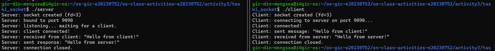
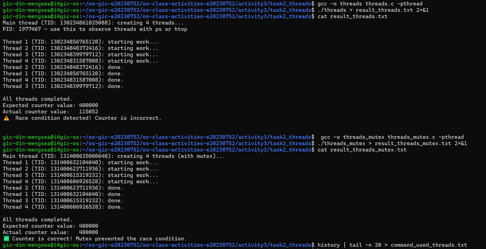
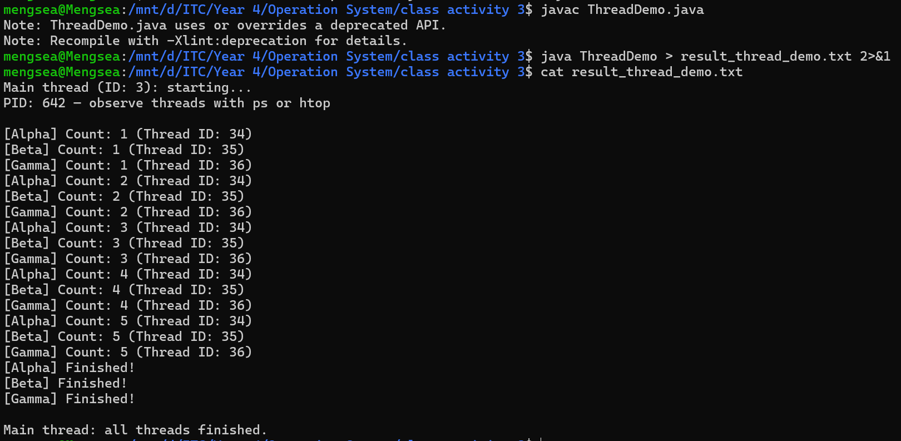
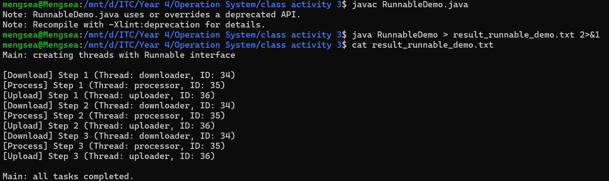
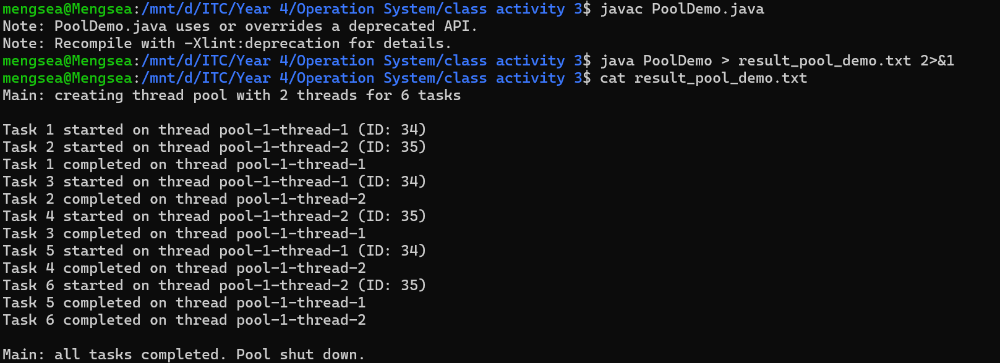
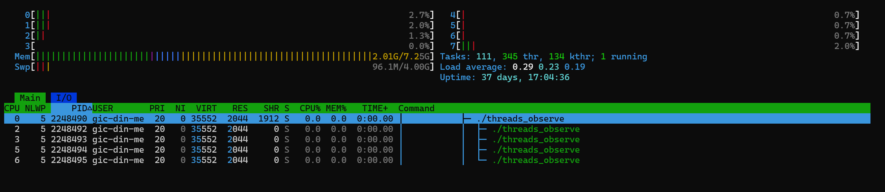
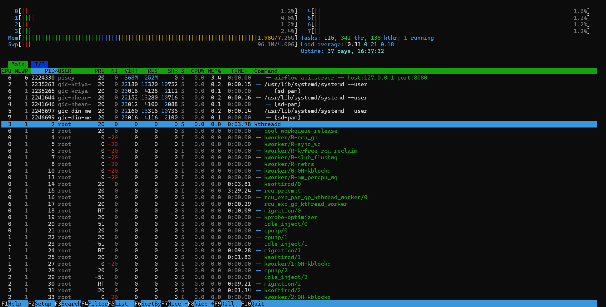
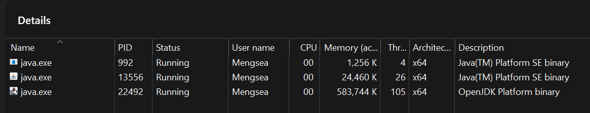

# Class Activity 3 — Socket Communication & Multithreading

- **Student Name:** DIN MENGSEA
- **Student ID:** e20230752
- **Date:** 11/11/2026

---

## Task 1: TCP Socket Communication (C)

### Compilation & Execution

First, compile the server and client programs:

```bash
gcc -o server server.c
gcc -o client client.c
```

Start the server in the first terminal:

```bash
./server
```

Then, open a second terminal and run the client:

```bash
./client
```

The server listens on port `8080` and waits for an incoming client connection. The client connects to the server using the IP address `127.0.0.1`.

After establishing the connection, the client sends the message `"Hello from client!"`. The server receives the message and responds with `"Hello from server!"`.

**Screenshot — Server and Client Communication**



### Answers

**1. Role of `bind()` / Why client doesn't call it:**

`bind()` assigns a specific local IP address and port number to a socket. In this program, the server uses `bind()` to associate its socket with port `8080`, allowing clients to find and connect to the server at that address.

The client does not normally need to call `bind()` because the operating system automatically assigns an available local IP address and an ephemeral port when the client connects. The client only needs to specify the server's IP address and port using `connect()`.

**2. What `accept()` returns:**

`accept()` returns a new socket file descriptor when an incoming client connection is successfully accepted. This new descriptor is used for communication with that particular client, such as receiving and sending data.

It is different from the original server socket. The original server socket remains the listening socket, which waits for incoming connections. The accepted socket represents the established connection with the client.

In this program:
- `server_fd` is the original listening socket.
- `client_fd` is the new connected socket used to communicate with the client.

**3. Starting client before server:**

If the client is started before the server is running or listening on the specified address and port, the client's `connect()` call fails because no server is accepting the connection.

For this local TCP example, the usual error message is:

```text
connect: Connection refused
```

This happens because the operating system cannot find a listening server at `127.0.0.1:8080`.

The client program then closes its socket and exits because the connection attempt failed. Therefore, the server should be started first, followed by the client.

**4. What `htons()` does:**

`htons()` means **Host To Network Short**. It converts a 16-bit port number from the computer's host byte order into network byte order, which is big-endian.

Different computer architectures may store multi-byte numbers in different byte orders. Network protocols use a standard byte order so that communicating systems interpret values consistently.

Therefore, `htons(PORT)` is used when assigning the port number to the socket address structure.

**5. Socket call sequence diagram:**

The following diagram illustrates the sequence of socket function calls on both the server and client sides.

```text
          SERVER                                      CLIENT
   -------------------------                  -------------------------
   socket()                                   socket()
      |                                          |
   bind()                                       |
      |                                          |
   listen()                                     |
      |                                      connect()
   accept() <----------- TCP connection ------> |
      |                                          |
   read()/recv() <--------- client message --- send()
      |                                          |
   send() ------------ server response ------> read()/recv()
      |                                          |
   close(client_fd)                           close(sock_fd)
      |
   close(server_fd)
```

**Explanation of the sequence:**

- **Server:** `socket()` creates the listening socket. `bind()` assigns its IP address and port. `listen()` makes it ready to accept connections. `accept()` waits for and accepts an incoming client connection.

- **Client:** `socket()` creates the client socket. `connect()` requests a connection to the server using its IP address and port.

- **Data exchange:** The client sends a message using `send()`, and the server receives it using `read()`. The server then sends a response using `send()`, which the client receives using `read()`.

- **Closing:** Both sides close their connected sockets after communication is complete. The server also closes its original listening socket.

---


## Task 2: POSIX Threads (C)

### Output — Without Mutex (Race Condition)

First, compile the C program using the `-pthread` flag:

```bash
gcc -o threads threads.c -pthread
```

Run the program:

```bash
./threads
```

The program creates four threads. Each thread increments the shared variable `shared_counter` 100,000 times. The expected final value is 400,000.

However, because multiple threads access and modify the shared variable simultaneously without synchronization, a race condition may occur. As a result, the actual counter value may be different from the expected value.

### Output — With Mutex (Correct)

To prevent the race condition, compile and execute the mutex version:

```bash
gcc -o threads_mutex threads_mutex.c -pthread
./threads_mutex
```

In this version, `pthread_mutex_lock()` and `pthread_mutex_unlock()` are used to protect the shared counter during each increment operation.

Only one thread can access the protected critical section at a time. Therefore, the final counter value should consistently be 400,000.

### Screenshot — Threads Output



### Answers

**1. What is a race condition? Why does `shared_counter` produce an incorrect result in `threads.c`?**

A race condition occurs when multiple threads access and modify shared data simultaneously, and the final result depends on the order in which the threads execute.

In `threads.c`, all four threads share the variable `shared_counter`. Each thread attempts to increment it 100,000 times. However, the increment operation (`shared_counter++`) is not atomic. It involves reading the current value, increasing it, and writing the new value.

If two or more threads perform these operations at the same time, their updates may overwrite one another. Consequently, some increments can be lost, causing the actual counter value to be lower than the expected value of 400,000.

**2. What does `pthread_mutex_lock()` do? Why does it fix the race condition?**

`pthread_mutex_lock()` locks a mutex to provide mutual exclusion when accessing shared resources.

When one thread locks the mutex, other threads attempting to lock the same mutex must wait until the first thread unlocks it.

In `threads_mutex.c`, the mutex protects the increment operation:

```c
pthread_mutex_lock(&counter_mutex);
shared_counter++;
pthread_mutex_unlock(&counter_mutex);
```

This ensures that only one thread can modify `shared_counter` at a time. It prevents multiple threads from updating the variable simultaneously and avoids lost increments.

Therefore, the final counter value is consistently 400,000.

**3. What happens if you forget to call `pthread_join()`? Try removing it and describe the behavior.**

`pthread_join()` makes the calling thread wait until a specified thread finishes its execution.

If we remove `pthread_join()` from the program, the main thread does not wait for the worker threads to complete. When the main function finishes, the process terminates, and its remaining threads are terminated as well.

As a result, some worker threads may not finish their tasks, and the final counter value may not reach the expected value.

Without `pthread_join()`, the program also cannot guarantee that all worker threads have completed before the main thread continues or exits.

**4. How is a thread different from a process? What do threads share and what is private to each thread?**

A process is an independent program in execution with its own address space and system resources. A thread is a smaller unit of execution that runs within a process.

| Process | Thread |
|---|---|
| Has its own address space. | Shares the address space with other threads in the same process. |
| Has separate memory resources. | Shares code, data, and heap memory. |
| Communication between processes usually requires IPC mechanisms. | Threads can communicate through shared memory. |
| Creating a process generally requires more resources. | Creating a thread generally requires fewer resources. |
| Processes are isolated from one another. | Threads within a process can affect shared data. |

**What threads share:**
- Program code.
- Global and static variables.
- Heap memory.
- Open files and other process resources.

**What is private to each thread:**
- Thread stack.
- CPU registers.
- Program counter.
- Thread ID (TID).

Therefore, threads are useful for performing multiple tasks concurrently within the same process, but shared resources must be properly synchronized to prevent race conditions.


## Task 3: Java Multithreading

### ThreadDemo Output

First, compile the Java program:

```bash
javac ThreadDemo.java
```

Run the program:

```bash
java ThreadDemo
```

The program demonstrates how to create threads by extending the `Thread` class. It creates three threads named Alpha, Beta, and Gamma. Each thread performs a counting task from 1 to 5, with a 500-millisecond delay between each count.

The `start()` method starts the execution of each thread, while `join()` makes the main thread wait until all three threads finish.



### RunnableDemo Output

Compile and run the program:

```bash
javac RunnableDemo.java
java RunnableDemo
```

This program demonstrates how to create threads by implementing the `Runnable` interface.

It creates three tasks: Download, Process, and Upload. Each task performs three steps, with a 300-millisecond delay between each step.

Each task is assigned to a separate thread using the `Thread` constructor. The threads execute concurrently, so their outputs may appear in different orders.

The `join()` method ensures that the main thread waits until all three tasks have completed.



### PoolDemo Output

Compile and run the program:

```bash
javac PoolDemo.java
java PoolDemo
```

This program demonstrates thread pool management using Java's `ExecutorService`.

A fixed thread pool containing two threads is created using:

```java
ExecutorService pool = Executors.newFixedThreadPool(2);
```

Although six tasks are submitted to the pool, only two tasks can execute simultaneously. The remaining tasks wait in the queue until a thread becomes available.

The `shutdown()` method prevents new tasks from being submitted, while `awaitTermination()` makes the main thread wait for the submitted tasks to finish.



### Answers

**1. What is the difference between extending `Thread` and implementing `Runnable`? When would you prefer one over the other?**

Extending `Thread` means creating a new class that inherits from the `Thread` class and overrides its `run()` method to define the task that the thread will perform.

Implementing `Runnable` means creating a class that implements the `Runnable` interface and provides an implementation of its `run()` method. The Runnable object is then passed to a `Thread` object to execute the task.

The main differences are:

| Extending Thread | Implementing Runnable |
|---|---|
| Inherits from the `Thread` class. | Implements the `Runnable` interface. |
| The task and thread management are combined in one class. | Separates the task from the thread that executes it. |
| Cannot extend another class because Java supports single inheritance. | Can still extend another class. |
| Less flexible for sharing task logic. | More flexible and reusable. |

I would prefer implementing `Runnable` in most situations because it separates the task from thread management and allows the class to extend another class if necessary. However, extending `Thread` is suitable for simple examples where we want to customize thread behavior directly.

**2. In `PoolDemo`, why do only 2 tasks run simultaneously even though 6 are submitted?**

In `PoolDemo`, the program creates a fixed thread pool with two threads using:

```java
ExecutorService pool = Executors.newFixedThreadPool(2);
```

This limits the number of tasks that can execute simultaneously to two because the pool only has two available worker threads.

Although six tasks are submitted, only two tasks can run at the same time. The other four tasks wait in the queue until one of the running tasks finishes and a worker thread becomes available.

This approach controls concurrency and prevents the program from creating too many threads.

**3. What does `thread.join()` do in Java? What happens if you remove it from `ThreadDemo`?**

The `thread.join()` method makes the current thread wait until the specified thread finishes its execution.

In `ThreadDemo`, the main thread calls:

```java
t1.join();
t2.join();
t3.join();
```

This ensures that the main thread waits for Alpha, Beta, and Gamma to complete before printing:

```text
Main thread: all threads finished.
```

If we remove the `join()` calls, the main thread does not wait for the worker threads to finish. It may print the completion message before the other threads have completed their tasks.

However, the JVM normally continues running while these worker threads are still active because they are non-daemon threads. Therefore, removing `join()` does not automatically terminate the worker threads.

**4. Why is `ExecutorService` considered better than manually creating threads for large applications?**

`ExecutorService` is considered better because it provides a convenient way to manage and reuse threads without manually creating a new thread for every task.

Its advantages include:

- **Thread reuse:** It reuses existing worker threads instead of repeatedly creating new ones.
- **Resource management:** It controls the number of active threads and helps prevent excessive resource consumption.
- **Concurrency control:** It allows developers to limit how many tasks execute simultaneously.
- **Task management:** It provides methods such as `submit()`, `shutdown()`, and `awaitTermination()` to manage task execution.
- **Better scalability:** It makes applications easier to manage when handling many tasks.

Therefore, `ExecutorService` is a more efficient and organized approach for managing multiple concurrent tasks in large applications.

## Task 4: Observing Threads in Linux & Windows

### Part A: Observing Threads on Linux

#### 1. Running the Threaded C Program

First, I compiled the `threads_observe.c` program using the pthread library:

```bash
gcc -o threads_observe threads_observe.c -pthread
```

Then, I executed the program in the background:

```bash
./threads_observe &
```

The program created four worker threads. Each worker thread displayed its thread ID (TID) and slept for 60 seconds, allowing enough time to observe the threads using Linux commands and `htop`.

During my latest observation, the process ID (PID) was **2248490**.

#### 2. Observing Threads with `ps`

I used the following command to display all threads belonging to the `threads_observe` process:

```bash
ps -eLf | grep threads_observe
```

I also used the following command to display detailed thread information:

```bash
ps -T -p 2248490
```

The output shows five threads belonging to the same process. All threads share the same process ID (PID), but each thread has its own thread ID (TID).

#### 3. Observing Threads in `/proc`

Linux provides the `/proc` filesystem, which contains information about running processes and their threads.

I used the following command to list the thread directories:

```bash
ls /proc/2248490/task/
```

To count the number of threads, I executed:

```bash
ls /proc/2248490/task/ | wc -l
```

I also checked the process status:

```bash
grep -E 'Name|State|Threads' /proc/2248490/status
```

The program contains five threads in total: one main thread and four worker threads.

#### 4. Observing Threads with `htop`

I used `htop` to observe the threads interactively.

```bash
htop
```

I performed the following steps:

1. Pressed `F4` and entered `threads_observe` to filter the process.
2. Pressed `H` to display individual threads.
3. Pressed `F5` to enable tree view.
4. Observed the main thread and four worker threads.
5. Observed the CPU and NLWP columns.

The screenshot shows the `threads_observe` process with PID 2248490 and five threads in total.

The main thread has TID 2248490, while the four worker threads have their own thread IDs.

The CPU column shows the CPU cores on which the threads last ran, and the NLWP column indicates that the process contains five threads.

**Thread Information from htop:**

| Thread | PID | TID | CPU Core | NLWP |
|---|---:|---:|---:|---:|
| Main thread | 2248490 | 2248490 | 0 | 5 |
| Worker 1 | 2248490 | 2248492 | 2 | 5 |
| Worker 2 | 2248490 | 2248493 | 3 | 5 |
| Worker 3 | 2248490 | 2248494 | 5 | 5 |
| Worker 4 | 2248490 | 2248495 | 6 | 5 |

All five threads were in the sleeping state (S) because the program uses `sleep(60)`.

**Screenshot — htop Thread View**



#### 5. Visualizing Kernel Threads

##### (a) Using `htop`

I used `htop` to investigate the kernel threads.

I pressed `K` to show kernel threads and `F5` to enable tree view.

In the tree view, I identified `kthreadd` (PID 2), which is responsible for creating and managing kernel threads.

I also observed several kernel threads under `kthreadd`, including `kworker`, `ksoftirqd`, and `rcu_preempt`.

**Screenshot — Kernel Threads in htop**



##### (b) Using Linux Commands

I also used Linux commands to inspect kernel threads directly.

First, I checked `kthreadd`:

```bash
ps -p 2 -o pid,ppid,comm
```

The output confirmed that `kthreadd` has PID 2 and PPID 0.

Next, I displayed its child processes:

```bash
ps --ppid 2 -o pid,ppid,psr,comm | head -15
```

I successfully identified several kernel threads, including:

- `ksoftirqd/0`
- `rcu_preempt`
- `kworker/R-rcu_gp`
- `migration/0`
- `kworker/R-sync_wq`

These threads have PPID 2, indicating that they are children of `kthreadd`.

I also used the following command to search for kernel threads:

```bash
ps -e -o pid,ppid,comm | grep -E 'kthreadd|kworker|ksoftirqd|rcu'
```

**Screenshot — Terminal Output of Commands (1) and (3)**

and(3).png)

##### (c) Comparing What I Observed

- **Comparison between `htop` and `ps`:** Both commands can display thread information. `htop` provides a live and interactive interface, while `ps` displays information as text that can be saved and compared.
- **Main thread and worker threads:** The main thread has a TID equal to the process PID (2248490). The four worker threads have their own unique thread IDs. The total number of threads (NLWP) is 5.
- **PSR and PROCESSOR:** PSR in `ps` and PROCESSOR in `htop` represent the CPU core on which a thread last ran. Both provide the same type of information.
- **Kernel threads:** Kernel threads do not have their own user-space address space. I identified `ksoftirqd/0`, `rcu_preempt`, and `kworker/R-rcu_gp` using Linux commands.
- **Environment observation:** I successfully identified kernel threads using both `htop` and `ps`, and confirmed that they are managed under `kthreadd`.

#### 6. Cleaning Up

After completing the observation, I terminated the background `threads_observe` process.

```bash
kill 2248490
```

This stopped the observation program after the required information had been collected.

---

### Part B: Observing Threads on Windows (Java)

#### 1. Running Java Programs

I used PowerShell on Windows to compile and execute the Java multithreading program.

```powershell
javac ThreadDemo.java
java ThreadDemo
```

The program demonstrates Java multithreading by creating three worker threads named Alpha, Beta, and Gamma.

Each thread performs a counting task with a 500-millisecond delay.

#### 2. Observing Threads in Task Manager

While the Java programs were running, I opened Windows Task Manager using:

```text
Ctrl + Shift + Esc
```

I followed these steps:

1. Opened the Details tab.
2. Located the `java.exe` processes.
3. Right-clicked the column headers.
4. Selected Select columns.
5. Enabled the Threads column.
6. Observed the thread counts of the Java processes.

The screenshot shows three Java processes with different process IDs and thread counts.

| Process | PID | Thread Count |
|---|---:|---:|
| java.exe | 992 | 4 |
| java.exe | 13556 | 26 |
| java.exe | 22492 | 105 |

The thread counts differ because multiple Java processes may run independently, and the JVM creates additional internal threads to manage its operations.

**Screenshot — Windows Task Manager**



---

### Answers

**1. In the `ps -eLf` output, what is the LWP column? How does it relate to threads?**

LWP stands for Lightweight Process. In Linux, it represents the thread ID (TID) of an individual thread.

Each thread within the same process has its own LWP ID, while all threads belonging to that process share the same PID.

Therefore, the LWP column allows us to identify individual threads running inside a process.

**2. How many entries did you find in `/proc/<PID>/task/`? Does it match the number of threads in your program (including the main thread)?**

I expected to find five entries in `/proc/2248490/task/`, representing one main thread and four worker threads.

This matches the program design because it creates four additional threads using `pthread_create()`, in addition to the main thread.

Therefore, the total number of threads is five.

**3. In Task Manager, why does `java.exe` show more threads than the 3 you created? What are the extra threads?**

The `java.exe` process can show more threads than the three worker threads created by the programmer because the Java Virtual Machine (JVM) creates additional internal threads to manage its operations.

These extra threads perform tasks such as:

- Garbage collection: Reclaiming unused memory.
- JIT compilation: Compiling frequently executed Java code.
- JVM management: Monitoring and managing the Java application.
- Background operations: Supporting JVM execution and runtime services.

Therefore, the total thread count includes both application threads and JVM internal threads.

**4. Compare how Linux (`ps`, `/proc`) and Windows (Task Manager) display threads. Which gives more detail?**

Linux and Windows provide different ways to observe threads.

| Linux | Windows |
|---|---|
| Uses `ps` to display detailed thread information. | Uses Task Manager to display thread counts. |
| Uses `/proc/<PID>/task/` to list individual thread IDs. | Task Manager displays the total number of threads in a process. |
| Provides information such as PID, LWP, NLWP, PSR, and thread state. | Provides a graphical interface for monitoring processes and resource usage. |

Linux provides more detailed information about individual threads through `ps` and `/proc`, while Windows Task Manager provides a simpler graphical overview.

Therefore, Linux provides more detailed thread-level information.

**5. What is `kthreadd`, and what is its PID? Name three kernel threads you found in `htop` or `ps`, and say how you can tell that they are kernel threads.**

`kthreadd` is a special kernel thread responsible for creating and managing other kernel threads.

Its PID is 2.

I identified the following kernel threads:

1. `ksoftirqd/0`
2. `rcu_preempt`
3. `kworker/R-rcu_gp`

I can identify them as kernel threads because their parent process ID (PPID) is 2, meaning they are children of `kthreadd`.

They are managed by the Linux kernel rather than being ordinary user-space processes.

**6. In `htop` and in the output of `ps -L`, which thread has an ID equal to the PID, and what is NLWP? On which cores (PSR or PROCESSOR) did your threads run?**

The main thread has a TID equal to the process PID, which is 2248490.

The NLWP column indicates the total number of threads belonging to the process. In my observation, NLWP is 5, consisting of one main thread and four worker threads.

According to my `htop` screenshot, the threads last ran on the following CPU cores:

| Thread ID | CPU Core |
|---|---:|
| 2248490 (Main) | 0 |
| 2248492 | 2 |
| 2248493 | 3 |
| 2248494 | 5 |
| 2248495 | 6 |

The CPU core numbers may change between observations because the operating system scheduler can assign threads to different CPU cores.

**7. What do the keys `H` and `K` do in `htop`? What would you not see without them?**

- `H`: Shows or hides individual user threads belonging to each process.
- `K`: Shows or hides kernel threads.

Without `H`, I would not see individual threads of a multithreaded user process. Without `K`, kernel threads would be hidden from the normal process list.

These keys help users understand how the operating system manages both user threads and kernel threads.

---

### Reflection

Through this activity, I learned how to observe threads at the operating system level using Linux and Windows tools. I understood how multiple threads belong to the same process while maintaining their own thread IDs.

I also learned how Linux uses `kthreadd` to manage kernel threads and how commands such as `ps`, `/proc`, and `htop` help monitor thread information.

Furthermore, I understood that the Java Virtual Machine creates additional internal threads beyond the threads created by the programmer.

Overall, this activity helped me understand how operating systems manage, schedule, and execute multiple threads concurrently.