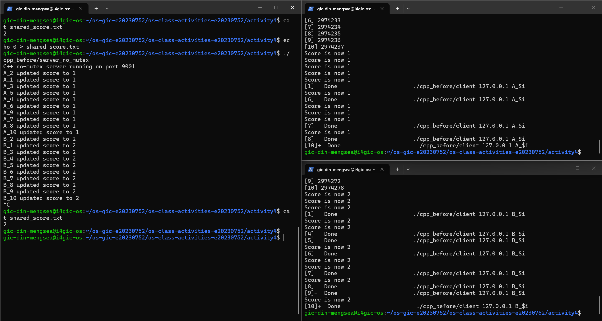
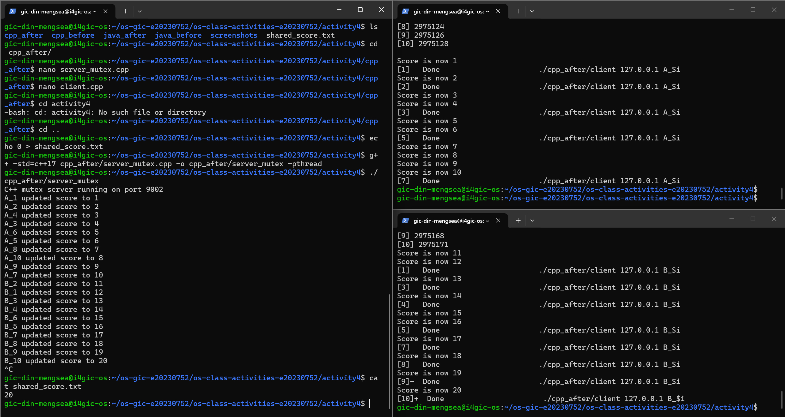
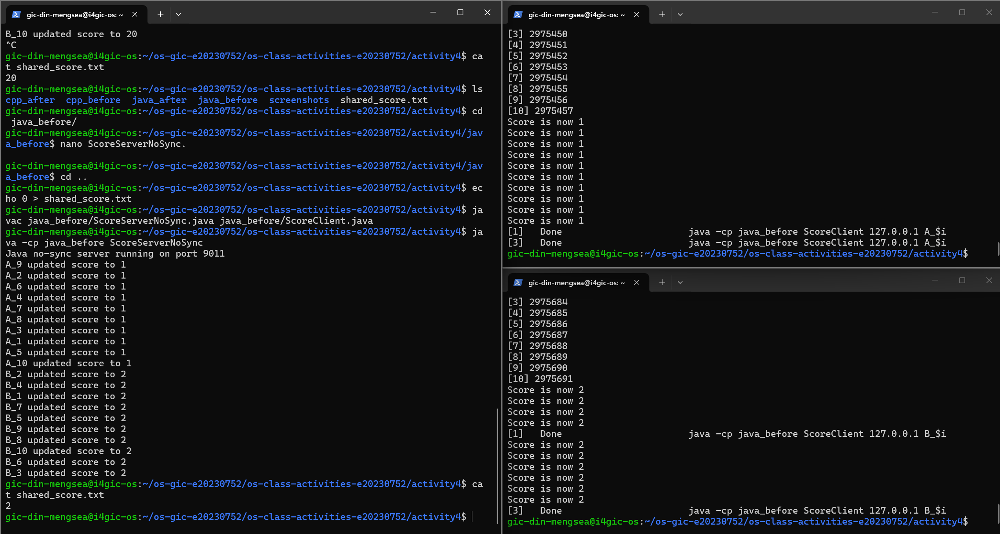
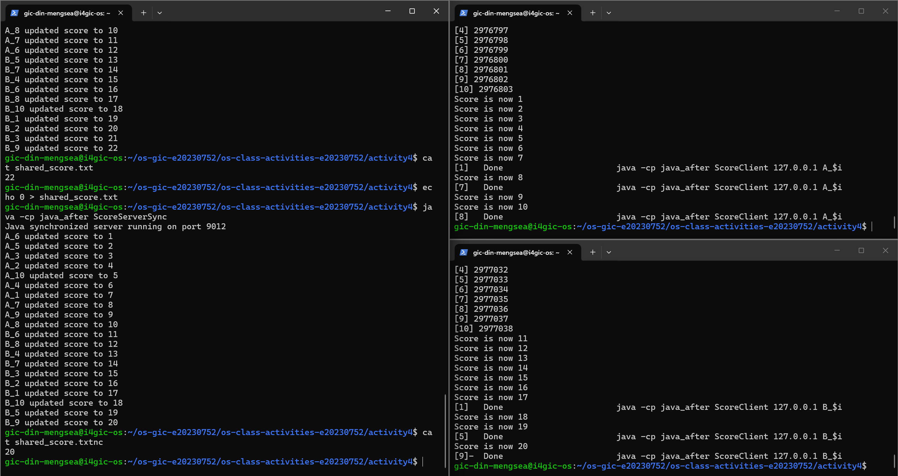

# Class Activity 4 — Shared File API: C++ Mutex & Java `synchronized`

- **Student Name:** Din Mengsea
- **Student ID:** e20230752
- **Partner Name:** Em Mengleang
- **Partner Student ID:** e20230450
- **Server Machine Owner:** Din Mengsea
- **Server IP Address:** 127.0.0.1

---

## Task 1: C++ Server Before Mutex

### Compilation & Execution

First, initialize the shared score file with 0.

```bash
echo 0 > shared_score.txt
```

Compile the C++ server:

```bash
g++ -std=c++17 cpp_before/server_no_mutex.cpp -o cpp_before/server_no_mutex -pthread
```

Start the server:

```bash
./cpp_before/server_no_mutex
```

The server runs on port `9001` and creates a separate thread for each client request.

**Student A — Send 10 requests:**

```bash
for i in {1..10}; do ./cpp_before/client 127.0.0.1 A_$i & done
wait
```

**Student B — Send 10 requests:**

```bash
for i in {1..10}; do ./cpp_before/client 127.0.0.1 B_$i & done
wait
```

### Execution Output

The server received requests from both students. However, multiple threads accessed and modified the shared file concurrently.

Example server output:

```text
C++ no-mutex server running on port 9001

A_1 updated score to 1
A_2 updated score to 1
A_3 updated score to 1
A_4 updated score to 1
A_5 updated score to 1
...
A_10 updated score to 1

B_1 updated score to 2
B_2 updated score to 2
B_3 updated score to 2
...
B_10 updated score to 2
```

- **Expected score after 20 requests:** 20
- **Actual observed score:** 2

### Screenshot



### Explanation

The actual score was less than the expected score of 20 because the server did not use synchronization when accessing the shared file.

Multiple client threads could read the same score before another thread finished updating it. Each thread then incremented its local copy and wrote the result back to the file.

As a result, some updates were overwritten by other threads. This problem is known as a **race condition**, specifically the lost update problem.

---

## Task 2: C++ Server After Mutex

### Compilation & Execution

To solve the race condition in Task 1, a mutex was added to protect the shared file update operation.

The following changes were made to the original server program:

1. Include the `<mutex>` header.
2. Declare a global mutex named `file_mutex`.
3. Change the server port from `9001` to `9002`.
4. Use `std::lock_guard<std::mutex>` inside the `update_score()` function.

The important code is:

```cpp
#include <mutex>

std::mutex file_mutex;

int update_score(const std::string& name) {
    std::lock_guard<std::mutex> lock(file_mutex);

    std::ifstream input(FILE_NAME);
    int score = 0;
    input >> score;
    input.close();

    std::this_thread::sleep_for(std::chrono::milliseconds(200));

    score++;

    std::ofstream output(FILE_NAME);
    output << score << std::endl;
    output.close();

    std::cout << name << " updated score to " << score << std::endl;
    return score;
}
```

Compile the server:

```bash
g++ -std=c++17 cpp_after/server_mutex.cpp -o cpp_after/server_mutex -pthread
```

Compile the client:

```bash
g++ -std=c++17 cpp_after/client.cpp -o cpp_after/client
```

Initialize the shared score file:

```bash
echo 0 > shared_score.txt
```

Start the server:

```bash
./cpp_after/server_mutex
```

The server now runs on port `9002`.

**Student A — Send 10 requests:**

```bash
for i in {1..10}; do ./cpp_after/client 127.0.0.1 A_$i & done
wait
```

**Student B — Send 10 requests:**

```bash
for i in {1..10}; do ./cpp_after/client 127.0.0.1 B_$i & done
wait
```

### Execution Output

Expected server output:

```text
C++ mutex server running on port 9002

A_1 updated score to 1
B_1 updated score to 2
A_2 updated score to 3
B_2 updated score to 4
...
A_10 updated score to 19
B_10 updated score to 20
```

- **Expected score after 20 requests:** 20
- **Actual score:** [20]

Check the final score using:

```bash
cat shared_score.txt
```

### Screenshot



### Explanation

After adding `std::mutex` and `std::lock_guard<std::mutex>`, the server can protect the shared file update operation from simultaneous access by multiple threads.

When one thread enters the `update_score()` function, it acquires the mutex lock. Other threads attempting to execute the same protected operation must wait until the current thread finishes and releases the lock.

The `std::lock_guard<std::mutex>` automatically releases the lock when the function exits.

Therefore, each client request can read the latest score, increment it, and write the updated value without another thread interfering with the operation.

The final score is expected to be 20 because all 20 client requests are processed without losing updates.

## Task 3: Java Server Before Synchronized

### Compilation & Execution

First, initialize the shared score file with 0.

```bash
echo 0 > shared_score.txt
```

Compile the Java server and client:

```bash
javac java_before/ScoreServerNoSync.java java_before/ScoreClient.java
```

Start the Java server:

```bash
java -cp java_before ScoreServerNoSync
```

The server runs on port `9011` and creates a new thread for each client connection.

**Student A — Send 10 requests:**

```bash
for i in {1..10}; do java -cp java_before ScoreClient 127.0.0.1 A_$i & done
wait
```

**Student B — Send 10 requests:**

```bash
for i in {1..10}; do java -cp java_before ScoreClient 127.0.0.1 B_$i & done
wait
```

### Execution Output

The Java server receives requests from both students and processes each request using a separate thread.

Example server output:

```text
Java no-sync server running on port 9011

A_1 updated score to 1
B_1 updated score to 1
A_2 updated score to 2
B_2 updated score to 2
...
```

- **Expected score after 20 requests:** 20
- **Actual score:** [2]

Check the final score:

```bash
cat shared_score.txt
```

### Screenshot



### Explanation

In this task, the Java server handles multiple client requests concurrently by creating a new thread for each client connection.

However, the `updateScore()` method does not use the `synchronized` keyword. Therefore, multiple threads can access and modify the shared file at the same time.

When several threads read the same score before another thread finishes writing its update, some increments may be lost.

This causes a race condition, specifically the lost update problem, resulting in an actual score that may be lower than the expected score of 20.

---

## Task 4: Java Server After Synchronized

### Compilation & Execution

To solve the race condition in Task 3, the `synchronized` keyword was added to the `updateScore()` method.

The following changes were made:

1. Change the server port from `9011` to `9012`.
2. Add the `synchronized` keyword to the `updateScore()` method.
3. Change the server message to indicate that the synchronized server is running.

The important code is:

```java
private static synchronized int updateScore(String name) throws Exception {
    File file = new File(FILE_NAME);
    int score = 0;

    if (file.exists()) {
        BufferedReader reader = new BufferedReader(new FileReader(file));
        String line = reader.readLine();
        reader.close();

        if (line != null && !line.isBlank()) {
            score = Integer.parseInt(line.trim());
        }
    }

    Thread.sleep(200);

    score++;

    FileWriter writer = new FileWriter(file, false);
    writer.write(score + "\n");
    writer.close();

    System.out.println(name + " updated score to " + score);
    return score;
}
```

Compile the Java server and client:

```bash
javac java_after/ScoreServerSync.java java_after/ScoreClient.java
```

Initialize the shared score file:

```bash
echo 0 > shared_score.txt
```

Start the server:

```bash
java -cp java_after ScoreServerSync
```

The server runs on port `9012`.

**Student A — Send 10 requests:**

```bash
for i in {1..10}; do java -cp java_after ScoreClient 127.0.0.1 A_$i & done
wait
```

**Student B — Send 10 requests:**

```bash
for i in {1..10}; do java -cp java_after ScoreClient 127.0.0.1 B_$i & done
wait
```

### Execution Output

The server processes the client requests while allowing only one thread at a time to execute the synchronized `updateScore()` method.

Expected server output:

```text
Java synchronized server running on port 9012

A_1 updated score to 1
B_1 updated score to 2
A_2 updated score to 3
B_2 updated score to 4
...
A_10 updated score to 19
B_10 updated score to 20
```

- **Expected score after 20 requests:** 20
- **Actual score:** [20]

Check the final score:

```bash
cat shared_score.txt
```

### Screenshot



### Explanation

After adding the `synchronized` keyword to the `updateScore()` method, the server can prevent multiple threads from executing the method simultaneously.

Because the method is static and synchronized, Java uses the class-level lock to control access to the method.

When one thread enters the method, it acquires the lock. Other threads attempting to call the same synchronized method must wait until the current thread finishes and releases the lock.

As a result, each thread can safely read, increment, and write the shared score without interfering with other threads.

The final score is expected to be 20 because all 20 client requests are processed without losing updates.

---

## Questions

### 1. Why should clients send requests to the server instead of writing the file directly?

Clients should send requests to the server because the server acts as a centralized controller for accessing and updating the shared file.

This prevents multiple clients from directly modifying the same file and makes it easier to manage access to shared resources. The server can also apply synchronization to protect the file from race conditions.

### 2. Why does the server still have a race condition before mutex or `synchronized`?

The server creates a separate thread for each client. Therefore, multiple threads can execute the file update operation simultaneously.

Without synchronization, two or more threads may read the same score, increment their own copies, and write the results back to the file.

This can cause some updates to be overwritten, resulting in lost updates and an incorrect final score.

### 3. In the C++ fixed version, what does `std::lock_guard<std::mutex>` protect?

`std::lock_guard<std::mutex>` protects the critical section inside the `update_score()` function.

It automatically locks the mutex when the lock guard is created and unlocks it when the lock guard goes out of scope.

This ensures that only one thread at a time can execute the protected file update operation.

### 4. In the Java fixed version, what does `synchronized` protect?

The `synchronized` keyword protects the `updateScore()` method from being executed by multiple threads simultaneously.

Since the method is static and synchronized, Java uses the class-level lock.

Only one thread can execute this method at a time, preventing concurrent modifications of the shared file by threads within that server.

### 5. Why is the final score expected to be 20 when Student A sends 10 requests and Student B sends 10 requests?

The final score is expected to be 20 because each client request increases the shared score by exactly one.

Student A sends 10 requests, and Student B sends another 10 requests.

Therefore:

```text
Initial score = 0

Student A = 10 requests
Student B = 10 requests

Final score = 0 + 10 + 10
            = 20
```

When synchronization is implemented correctly, every increment is processed without losing updates, so the final score should be 20.

### 6. What could happen if two separate servers update the same file at the same time?

If two separate servers update the same file simultaneously, race conditions can still occur because each server may have its own mutex or synchronization mechanism.

A mutex in one server does not automatically protect the file from another server's threads.

For example, both servers might read the same score, increment their own copies, and write their results back. One server's update could overwrite the other server's update.

This can cause lost updates and an incorrect final score. A synchronization mechanism shared between the servers or a suitable file/database locking mechanism would be needed to prevent this problem.

---

## Reflection

This activity helped me understand the importance of synchronization when multiple threads access and modify shared resources.

In C++, `std::mutex` is used together with `std::lock_guard<std::mutex>` to protect the critical section. The lock guard automatically manages the locking and unlocking process.

In Java, the `synchronized` keyword provides a built-in mechanism for controlling access to a method or block of code. It ensures that only one thread at a time can execute the protected method using the same lock.

Both approaches help prevent race conditions and lost updates when multiple threads access a shared resource.

Through this activity, I learned that creating a server to manage shared file access is not enough by itself. Synchronization is also necessary to ensure data consistency and correctness when handling concurrent client requests.