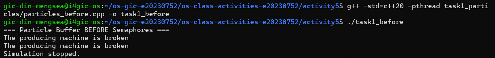
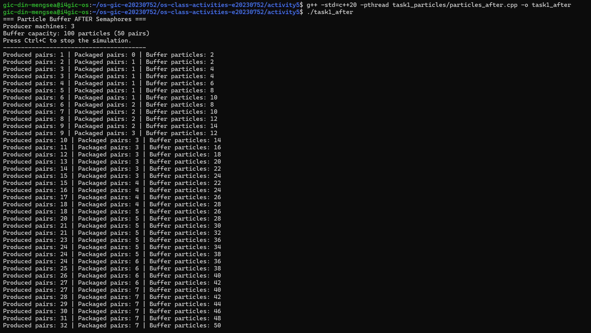
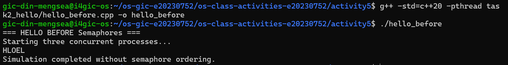
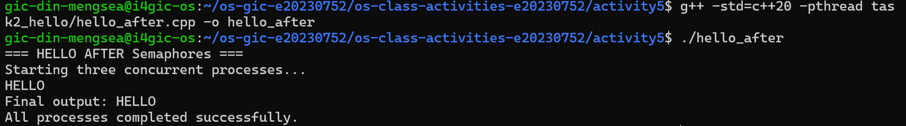

# Class Activity 5 – Semaphores

- **Student Name:** Din Mengsea
- **Student ID:** e20230752
- **Programming Language Used:** C++

---

## Task 1A: Particle Pair Buffer Before Semaphores



- **What error or incorrect behavior appeared:**

  The program displayed the following error:

  ```text
  The producing machine is broken
  The producing machine is broken
  Simulation stopped.
  ```

- **Why did this happen without semaphore protection:**

  Multiple producer threads were accessing the shared buffer without proper synchronization. The producers could add particles faster than the consumer removed them. Eventually, the buffer reached its maximum capacity of 100 particles. When a producer attempted to insert another particle, the program detected a buffer overflow and displayed the error message.

---

## Task 1B: Particle Pair Buffer After Semaphores



- **Number of producer machines:** 3
- **Number of consumer machines:** 1
- **Buffer capacity:** 100 particles (50 particle pairs)
- **Semaphores used:**
  - `empty_pairs`: Initialized to 50, counts available pair spaces.
  - `full_pairs`: Initialized to 0, counts completed pairs available for packaging.
  - `buffer_mutex`: Initialized to 1, protects the shared buffer from simultaneous access.
- **Produced pair count shown in screenshot:** [Enter the number from your screenshot]
- **Packaged pair count shown in screenshot:** [Enter the number from your screenshot]
- **Did any error appear during normal operation?**

  No. The semaphore mechanism prevents producers from exceeding the buffer capacity and prevents the consumer from removing unavailable pairs. Both particles are inserted consecutively and checked before packaging.

---

## Task 2A: HELLO Before Semaphores



- **Output before semaphore ordering:**

  The three concurrent threads independently printed their assigned letters. The output could appear in an incorrect order instead of `HELLO`.

- **Why this output can be wrong or unpredictable:**

  Without semaphores, the operating system scheduler determines when each thread executes. Process 1, Process 2, and Process 3 can execute in different orders. Therefore, there is no guarantee that the letters will be printed in the correct sequence.

---

## Task 2B: HELLO After Semaphores



- **Processes or threads used:** 3 concurrent threads.
- **Semaphores used:**
  - `start_h`: Initialized to 1, allows Process 1 to start.
  - `after_e`: Initialized to 0, allows Process 2 to execute after Process 1.
  - `after_l2`: Initialized to 0, allows Process 3 to execute after Process 2.
- **Final output:**

  ```text
  HELLO
  ```

  The semaphores coordinate the execution order. Process 1 prints `H` and `E`, Process 2 prints `L` and `L`, and Process 3 prints `O`. Therefore, the program always produces the correct word.

---

## Questions

**1. In Task 1, why does a producer need to wait before adding a pair to the buffer?**

A producer needs to wait until at least two buffer spaces are available before adding a pair. This prevents buffer overflow and ensures that both particles can be inserted together.

**2. In Task 1, why does the consumer need to wait before removing a pair from the buffer?**

The consumer needs to wait until a complete pair is available. This prevents buffer underflow and ensures that the consumer does not remove particles that have not yet been produced.

**3. Which semaphore protects the critical section in your particle buffer program?**

The `buffer_mutex` semaphore protects the critical section. It ensures that only one thread can access and modify the shared particle buffer at a time.

**4. How does your program verify that P1 and P2 belong to the same pair?**

The program compares the machine ID and pair ID of both particles. It also checks that the first particle is P1 and the second particle is P2. If they do not match, the program displays `Pairs are incorrect`.

**5. In Task 2, why can the program print letters in the wrong order without semaphores?**

Because the three threads execute concurrently without synchronization. The operating system scheduler can switch between threads at any time, so the letters may be printed in an unpredictable order.

**6. Which semaphore or synchronization step forces H to print before E, L, L, and O?**

The `start_h` semaphore allows Process 1 to start first. Process 1 prints H and E before signaling `after_e`, which allows Process 2 to print the two L letters. After that, Process 2 signals `after_l2`, allowing Process 3 to print O.

**7. What could cause deadlock in either of your simulations?**

Deadlock could occur if a thread waits indefinitely for a semaphore that is never released. It could also happen if threads acquire multiple locks in an inconsistent order, causing each thread to wait for a resource held by another thread.

---

## Reflection

Through this activity, I learned how semaphores are used to synchronize concurrent threads and manage shared resources.

In Task 1, I observed how multiple producer threads could cause problems when accessing a shared buffer without proper synchronization. By using counting semaphores and a mutex semaphore, I learned how to control available buffer spaces, protect the critical section, and ensure that particles are produced and packaged in complete pairs.

In Task 2, I learned how semaphores can control the execution order of concurrent threads. Without synchronization, the letters could appear in an unpredictable order. By using semaphores to coordinate the three threads, I ensured that the output was always `HELLO`.

Overall, this activity helped me understand the importance of semaphores in preventing race conditions, managing shared resources, and controlling execution order in concurrent programming.