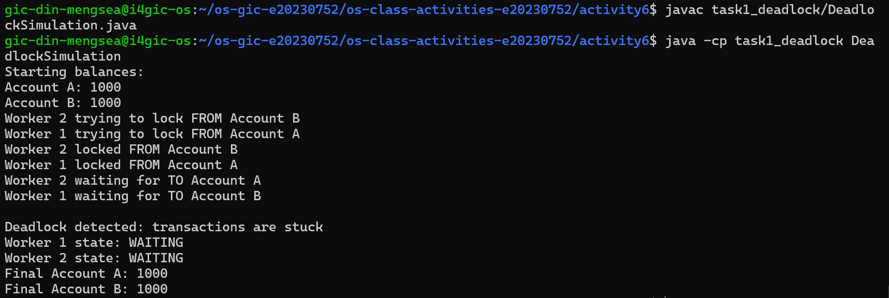
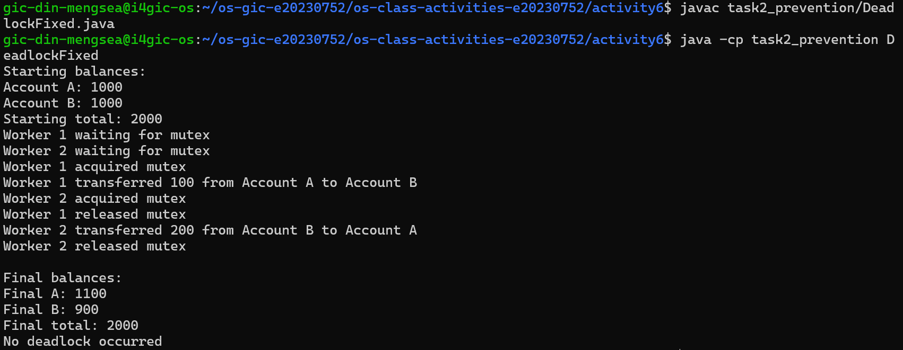

# Class Activity 6 - Deadlock Simulation

- **Student Name:** Din Mengsea
- **Student ID:** e20230752
- **Programming Language Used:** Java

---

## Task 1: Deadlock Version



- **Shared resources:** Account A and Account B. Each account has a balance and a semaphore lock initialized to 1.
- **Transaction 1:** Worker 1 transfers 100 from Account A to Account B. It locks Account A first and then waits for Account B.
- **Transaction 2:** Worker 2 transfers 200 from Account B to Account A. It locks Account B first and then waits for Account A.
- **Deadlock message shown:** `Deadlock detected: transactions are stuck`

**Explanation of why the program got stuck:**

The program got stuck because both workers acquired their first account locks and then attempted to acquire the other account's lock. Worker 1 held Account A while waiting for Account B, while Worker 2 held Account B while waiting for Account A.

Neither worker could continue because the required account was already locked by the other worker. This situation created a circular wait and resulted in deadlock.

A CountDownLatch was used to ensure both workers acquired their first locks before attempting to acquire the second locks. A watchdog using a timeout was also implemented to detect the deadlock after two seconds.

---

## Task 2: Deadlock Prevention Version



- **Prevention strategy used:** A single shared semaphore mutex protects the entire bank transfer operation. Each worker must acquire the mutex before updating account balances and release it after completing the transfer.
- **Semaphore mutex initial value:** 1
- **Starting total:** 2000
- **Final total:** 2000
- **Did both transfers complete?** Yes. Both workers successfully completed their transactions.
- **Why no deadlock occurred:**

The single semaphore mutex allows only one worker to execute the transfer operation at a time. When one worker acquires the mutex, the other worker must wait until the first worker finishes and releases it.

This prevents both workers from holding different account locks while waiting for each other. Therefore, circular wait is avoided and deadlock does not occur.

**Final account balances:**

- Account A: 1100
- Account B: 900
- Total: 2000

The total bank balance remains unchanged because transferring money between accounts only moves money from one account to another.

---

## Questions

**1. What are the two shared resources in your bank transaction simulation?**

The two shared resources are Account A and Account B. Both accounts are accessed by the two transaction workers. Each account contains a balance and a semaphore lock to control access.

**2. Which line or section of your Task 1 program creates hold-and-wait?**

The following section creates hold-and-wait:

```java
from.lock.acquire();

Thread.sleep(100);

to.lock.acquire();
```

A worker acquires the lock for its source account first and holds it while waiting to acquire the destination account's lock. This creates the hold-and-wait condition.

**3. How does Task 1 create circular wait?**

Task 1 creates circular wait because Worker 1 holds Account A and waits for Account B, while Worker 2 holds Account B and waits for Account A.

Each worker is waiting for a resource held by the other worker, creating a circular dependency.

**4. Why does the Task 1 program need a watchdog or timeout?**

The watchdog is necessary because a deadlocked program can remain stuck indefinitely. The watchdog checks whether the worker threads have completed within a specified time.

If the workers are still running after two seconds, the program prints:

`Deadlock detected: transactions are stuck`

This allows the program to demonstrate and report the deadlock instead of hanging silently.

**5. How does the single semaphore mutex prevent deadlock in Task 2?**

The single semaphore mutex is initialized to 1, meaning only one worker can enter the critical section at a time.

Before performing a transfer, each worker must acquire the mutex. After completing the transfer, it releases the mutex.

As a result, workers cannot simultaneously hold different account locks and wait for each other. This prevents circular waiting and avoids deadlock.

**6. Which of the four deadlock conditions does your Task 2 solution remove or avoid?**

Task 2 avoids the **hold-and-wait** and **circular-wait** conditions.

- Mutual exclusion still exists because only one worker can access the critical section at a time.
- Hold-and-wait is avoided because a worker must acquire the single mutex before accessing either account.
- No preemption is not necessarily removed.
- Circular wait is avoided because workers do not acquire separate account locks in opposite orders.

Therefore, the necessary conditions for deadlock are not all present, so deadlock cannot occur in this solution.

**7. Why must the final total bank balance remain unchanged after both transfers?**

The total bank balance must remain unchanged because transferring money between two accounts does not create or destroy money.

Worker 1 transfers 100 from Account A to Account B, and Worker 2 transfers 200 from Account B to Account A.

The final balances are:

- Account A = 1000 - 100 + 200 = 1100
- Account B = 1000 + 100 - 200 = 900

Therefore:

1000 + 1000 = 1100 + 900 = 2000

This confirms that the transactions preserve the total amount of money.

---

## Reflection

This activity helped me understand how deadlock occurs when multiple threads compete for shared resources. In Task 1, I observed that two workers could become stuck when each held one account lock and waited for the other account.

In Task 2, I learned how a semaphore mutex can prevent deadlock by controlling access to a critical section. Only one worker can perform a bank transfer at a time, ensuring that transactions are completed safely.

This concept is important in real-world systems such as banking applications, databases, and file systems, where multiple processes access shared resources simultaneously. Proper synchronization helps prevent deadlocks and maintain data consistency.