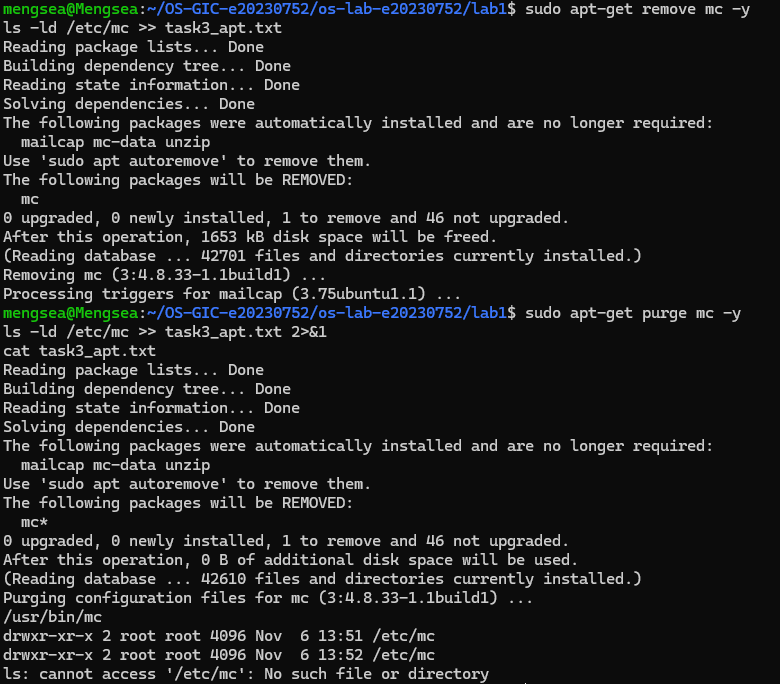
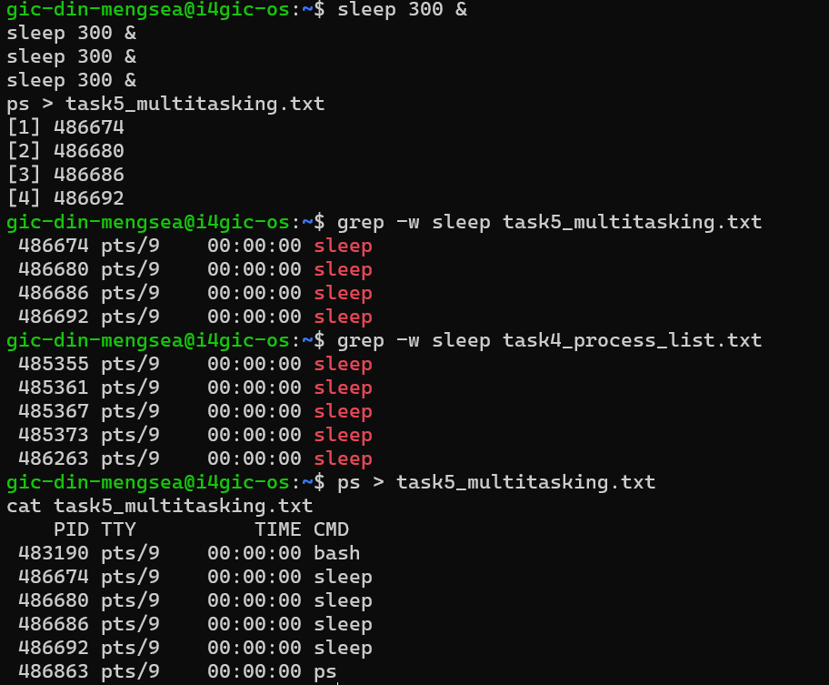
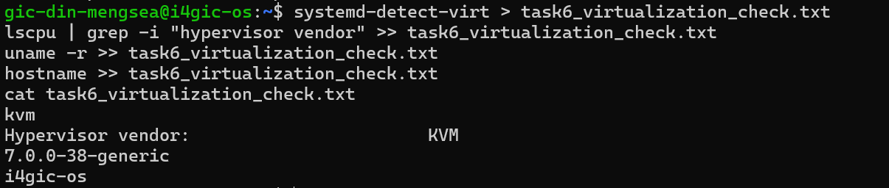

# OS Lab 1 Submission

Copy this template to `os-lab-YOUR_ID/lab1/README.md` in your own repository. Follow [the instructions](lab1-instruction.md). Your prediction and checkpoint answers are already saved by `oslab`; do not copy them here.

- **Student Name:** DIN MENGSEA
- **Student ID:** e20230752
- **Ubuntu username on the server:** gic-din-mengsea
- **My values** (`oslab values lab1`): file1 = river, file2 = rocket, count = 4

---

## Task 1: Operating System Identification

Briefly describe what you observed about your OS and kernel. Which number is the kernel version, and which is the distribution version?

The server runs Linux with Ubuntu 26.04.1 LTS as its distribution. According to the uname -a output, the kernel version is 7.0.0-38-generic, while the distribution version is 26.04, shown in the Release: line of lsb_release -a. The kernel is the core part of the operating system that manages hardware and system resources, while Ubuntu is the complete Linux distribution built around the kernel.


```text
Linux i4gic-os 7.0.0-38-generic #38-Ubuntu SMP PREEMPT_DYNAMIC Fri Sep  4 09:10:14 UTC 2026 x86_64 GNU/Linux
Distributor ID:	Ubuntu
Description:	Ubuntu 26.04.1 LTS
Release:	26.04
Codename:	resolute

```

---

## Task 2: Essential Linux File and Directory Commands

Briefly describe your experience creating, copying, renaming and deleting files. What did the last `ls` show?

I practised using basic Linux commands to manage files. I used touch to create files, echo to write content into them, cp to copy files, mv to rename files, and rm to delete files. I also used ls to check the directory contents after each operation. I learned that > overwrites existing content, while >> appends new content to a file.

The last `ls` showed: 


```text
/home/gic-din-mengsea/oslab-work/lab1/task2_files
river.txt
rocket.txt
task2_file_commands.txt
```

---

## Task 3: Package Management Using APT

Explain the difference you observed between `remove` and `purge`.

I learned that remove and purge have different effects when uninstalling a package. The sudo apt-get remove mc command removes the program but keeps its configuration files. In contrast, sudo apt-get purge mc removes both the program and its configuration files. I understood this difference by checking the /etc/mc directory: it still existed after using remove, but disappeared after using purge.

<!-- SCREENSHOT REQUIREMENT: your terminal after the purge, showing `ls -ld /etc/mc` and your prompt. -->




---

## Task 4: Programs vs Processes

Briefly describe how you ran a background process and found it in the process list. What is the difference between a program and a process? What did you see before, during and after?

I used the which sleep command to locate the sleep program on the system. Then, I ran sleep 30 & to start a background process. The & symbol allowed the process to run in the background while I continued using the terminal. I used the ps command to find the running process and check its PID.
- Before: The sleep program existed at /usr/bin/sleep, but no sleep process was running.
- During: After running sleep 30 &, a sleep process appeared in the process list with its own PID.
- After: Once 30 seconds had passed, the sleep process disappeared from the process list, but the program file remained on the system.
A program is an executable file stored on disk, while a process is an instance of a program that is currently running in memory. Each process has its own Process ID (PID).

```text
    PID TTY          TIME CMD
 479172 pts/3    00:00:00 bash
 482282 pts/3    00:00:00 sleep
 482334 pts/3    00:00:00 ps

```
---

## Task 5: Multitasking

Briefly describe the multitasking you saw. How many `sleep` lines did `ps` show? What does that show about the system, and what does it **not** show about how the processor is shared?

I started multiple sleep processes in the background using the sleep 300 & command. Each process received a different Process ID (PID). I then used the ps command to display the running processes. The output showed 3 sleep lines, along with the bash and ps processes.

This demonstrates that the operating system can keep multiple processes active at the same time. However, it does not show exactly how the CPU is shared between processes because ps only provides a snapshot of the running processes. The sleep processes spend most of their time waiting rather than actively using the CPU. Therefore, the output does not show how the CPU scheduler switches between processes.




---

## Task 6: Virtualization and Hypervisor Detection

State whether your system is running on a virtual machine or physical hardware, based on the command outputs.

Based on the command outputs, my system is running on a virtual machine (VM) rather than directly on physical hardware. The systemd-detect-virt command returned kvm, which indicates that the server is using KVM virtualization. The lscpu output also showed KVM as the hypervisor vendor, confirming that the system is running in a virtualized environment. The kernel version is 7.0.0-38-generic, and the hostname is i4gic-os.

<!-- SCREENSHOT REQUIREMENT: your terminal with the output of the four commands and your prompt. -->


---

## My Prediction: Confirmed or Corrected

1. Confirmed. I predicted that running three sleep processes in the background would show three sleep lines in the process list. In Task 5, the ps command showed exactly three sleep processes, each with a different PID.

2. Confirmed. I predicted that the sleep program would remain on the system after its process finished. In Task 4, the running process disappeared from the process list after 30 seconds, but the program file remained stored on disk.

3. Confirmed. I predicted that apt-get remove would remove the program but keep its configuration files. In Task 3, I observed that the configuration director

---

## Plus / Challenge

### About APT

I explored additional APT commands to understand package management in Ubuntu.
- apt-cache policy mc displays information about the package, including its installed version and the candidate version available for installation.
- apt list --installed | grep mc searches the list of installed packages for names containing mc.
- sudo apt-get update refreshes the package lists from software repositories.
- sudo apt-get upgrade installs available updates for installed packages.
- sudo apt autoremove removes packages that were automatically installed as dependencies but are no longer needed.
- tree displays files and directories in a tree-like structure, making it easier to understand the project folder organization.
Through these commands, I learned how to check package information, update installed software, remove unnecessary dependencies, and explore directory structures.

